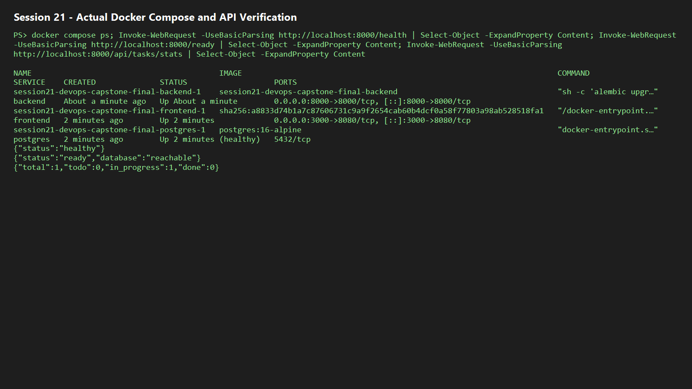
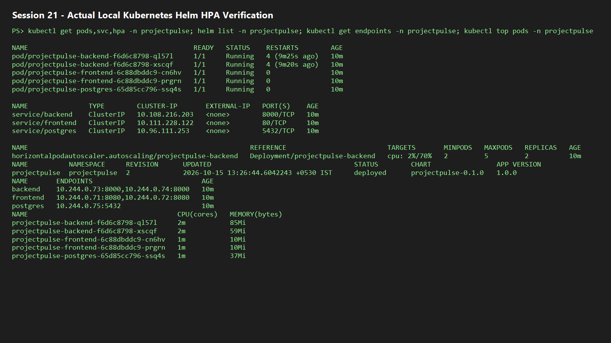
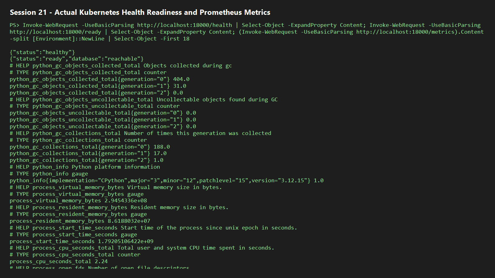

# Session 21 — ProjectPulse DevOps Capstone

ProjectPulse is an original SaaS-style delivery-board application. It demonstrates the journey from a React interface and FastAPI REST API through testing, containers, CI security gates, Terraform, Kubernetes, Helm, monitoring, and troubleshooting.

> The app is deliberately not a direct copy of the instructor's TaskBoard reference. ProjectPulse uses its own domain, UI, API structure, naming, documentation, and implementation.

## Architecture

```text
React/Vite + Nginx ── /api ──> FastAPI + SQLAlchemy ──> PostgreSQL
       │                           │
       └── GitHub Actions: pytest → build → Trivy → optional GHCR/deploy
                                   │
                  Terraform AWS VPC + EKS → Helm → Ingress/HPA → Prometheus/Grafana
```

## Delivered requirements

| Area | Implementation |
| --- | --- |
| Application | Responsive ProjectPulse dashboard, create-task modal, filters, loading/error state |
| API | `GET /api/tasks`, `GET /api/tasks/{id}`, `POST`, `PUT`, `DELETE`, stats, health, ready, metrics |
| Database | PostgreSQL through SQLAlchemy; Alembic migration in `backend/alembic/versions/` |
| Tests | Six isolated pytest cases against SQLite test DB |
| Containers | Non-root Python image; multi-stage Node-to-unprivileged-Nginx frontend image; Compose stack |
| CI/DevSecOps | GitHub Actions test/build workflow with two Trivy HIGH/CRITICAL gates |
| IaC | AWS VPC, two public subnets, IGW/routes, EKS control plane, and managed node group |
| Kubernetes | Namespace, Helm chart, 2 frontend/2 backend replicas, services, Ingress, HPA, probes, PVC |
| Observability | Prometheus `/metrics`, optional ServiceMonitor, Grafana/Prometheus values |
| Troubleshooting | Deliberately invalid image and Service selector manifests |

## Run locally

Prerequisite: Docker Desktop running.

```powershell
cd session21-devops-capstone-final
docker compose up --build
```

Open <http://localhost:3000>. The direct API documentation is <http://localhost:8000/docs>; health is <http://localhost:8000/health>; Prometheus metrics are <http://localhost:8000/metrics>.

### Actual local verification evidence

The Compose stack was built and run locally on 15 October 2026. PostgreSQL became healthy, the backend returned `/health` and database-checking `/ready`, and the task statistics endpoint returned data from the live stack.



```powershell
docker compose down        # stop
docker compose down -v     # stop and delete local database data
```

## Test locally

Python 3.12 is recommended (the workstation currently has Python 3.10; containers/CI use 3.12).

```powershell
cd backend
python -m venv .venv
.\.venv\Scripts\Activate.ps1
pip install -r requirements.txt
pytest -v
```

Tests use a separate SQLite test database and never your Compose PostgreSQL database.

## Kubernetes and Helm

Build images locally first, then deploy to a Docker Desktop/Minikube cluster:

```powershell
kubectl apply -f k8s/namespace.yaml
helm upgrade --install projectpulse ./helm/taskboard -n projectpulse -f helm/taskboard/values-dev.yaml
kubectl get pods,svc,hpa -n projectpulse
helm list -n projectpulse
```

### Actual local Kubernetes verification evidence

The complete Helm release was deployed to the local Minikube cluster on 15 October 2026. It includes two healthy frontend Pods, two healthy backend Pods, PostgreSQL, three ClusterIP Services, a backend HPA, service endpoints, and the deployed Helm release. A brief backend restart occurred during initial PostgreSQL startup; readiness probes kept it out of service until the database became available, and the deployment subsequently completed successfully.



The Kubernetes backend was then verified through a local port-forward. `/health` and database-checking `/ready` returned success, and `/metrics` emitted Prometheus-formatted application metrics.



An Ingress controller and Metrics Server are needed for Ingress and HPA behavior. The dev hostname is `taskboard.local`; map it to your ingress IP in your hosts file. Enable monitoring after installing kube-prometheus-stack:

```powershell
helm repo add prometheus-community https://prometheus-community.github.io/helm-charts
helm upgrade --install monitoring prometheus-community/kube-prometheus-stack -n monitoring --create-namespace -f monitoring/prometheus-values.yaml
```

## Terraform: real AWS only

`terraform/` deliberately targets real AWS because EKS cannot be realistically emulated locally. It creates billable resources. You need an AWS account, AWS CLI credentials with VPC/EKS/IAM permissions, and a spending budget before using it.

```powershell
cd terraform
Copy-Item terraform.tfvars.example terraform.tfvars
terraform init
terraform plan
terraform apply
# use the configure_kubectl output
terraform destroy
```

Never commit `terraform.tfvars`, `terraform.tfstate`, or access keys. Run `destroy` when finished.

## CI/CD and GHCR

The runnable workflow is at the repository root, `.github/workflows/session21-projectpulse.yml`, because GitHub Actions only detects root-level workflow files. A matching copy is kept under this session for the deliverable. It runs pytest, builds the frontend, builds both images, and scans both images with Trivy. It fails on HIGH/CRITICAL vulnerabilities. On every push to `main`, the `publish-ghcr` job signs in with the repository's built-in `GITHUB_TOKEN` and publishes backend and frontend images to GHCR using the exact commit SHA.

## Troubleshooting lab

```powershell
kubectl apply -f troubleshooting/broken-image.yaml
kubectl get pods -n projectpulse
kubectl describe pod -n projectpulse <pod-name>
kubectl get events -n projectpulse --sort-by=.lastTimestamp

kubectl apply -f troubleshooting/broken-service.yaml
kubectl get endpoints -n projectpulse broken-selector
kubectl get pods -n projectpulse --show-labels
```

`broken-image.yaml` demonstrates `ImagePullBackOff`; fix its image/tag. `broken-service.yaml` selects no Pods; correct the selector to `app: projectpulse-backend` and verify endpoints appear.

## What you need to install or create

Already available: Docker Desktop, Node, Helm, kubectl, and Terraform. Install Python 3.12 if you want to execute backend tests directly instead of through the CI/container runtime.

Optional/required only for the real cloud sections:

- AWS account and configured AWS CLI: Terraform VPC/EKS deployment; this may incur charges.
- GitHub Actions/GHCR: repository package permissions for image publication.
- A Kubernetes cluster plus NGINX Ingress Controller, Metrics Server, and kube-prometheus-stack: live Helm/HPA/Prometheus/Grafana demonstration.

## Local no-AWS submission checklist

The following is an honest completion record for this no-AWS submission. “Not applicable” means a real AWS account is the only legitimate way to produce that particular proof; it is not represented as completed.

### M1 — Application

- [x] FastAPI backend responds to `/health`.
- [x] CRUD REST APIs and task statistics are implemented.
- [x] PostgreSQL table is defined by an Alembic migration.
- [x] React dashboard makes API calls and has responsive/error/loading UI.
- [x] Local Compose stack verified with live API evidence.

### M2 — Tests and quality

- [x] `pytest -q` passes: 6 tests.
- [x] Tests cover health/readiness, create/read, list/filter, update, statistics/delete, and validation.
- [x] Tests use an isolated SQLite test database.
- [x] `pytest.ini` and `conftest.py` are included.

### M3 — Git and GitHub

- [x] Public GitHub repository is used.
- [x] Meaningful commits are present.
- [x] `.gitignore` excludes virtual environments, caches, databases, Node modules, and Terraform state.

### M4 — Docker

- [x] Backend non-root Dockerfile builds.
- [x] Frontend multi-stage Node-to-Nginx Dockerfile builds.
- [x] `docker compose up --build` runs frontend, backend, and PostgreSQL.
- [x] Local Compose/API screenshot is included above.

### M5/M6 — CI/CD and DevSecOps

- [x] Root GitHub Actions workflow triggers for Session 21 source changes.
- [x] Pytest, frontend build, Docker builds, Trivy HIGH/CRITICAL gates, and SHA-based GHCR publish jobs are configured.
- [x] GitHub Actions executed the real test, frontend-build, and backend-image-build stages from commit `e72d635`.
- [x] The Trivy HIGH/CRITICAL security gate was verified: it blocked promotion after the backend scan, so frontend scan and GHCR publication were correctly skipped. The gate is intentionally not bypassed.
- [ ] Green CI/GHCR package screenshot — pending remediation of the Trivy finding and a subsequent successful run. This needs only GitHub, not AWS.

### M7 — Terraform AWS infrastructure

- [x] Valid Terraform HCL, VPC, two public subnets, EKS, node-group design, outputs, and `terraform.tfvars.example` are included.
- [x] `terraform fmt` and `terraform validate` completed locally.
- [ ] **Not applicable without AWS account:** real `plan`, `apply`, AWS Console VPC/EKS screenshot, and `destroy` screenshot. These cannot be truthfully faked or emulated as EKS evidence.

### M8 — Kubernetes and Helm

- [x] Namespace manifest and complete Helm chart are included.
- [x] Helm release deployed successfully to local Minikube.
- [x] Two frontend and two backend replicas are Running.
- [x] ClusterIP backend/frontend/PostgreSQL Services and endpoints verified.
- [x] Backend HPA deployed (2–5 replicas); metrics API available.
- [x] Ingress, probes, PVC, and ServiceMonitor templates are included. Ingress is disabled in the local verification because a local NGINX Ingress controller is not installed.
- [x] Live local Kubernetes/Helm screenshot is included above.

### M9 — Observability

- [x] Live Prometheus-formatted `/metrics` output captured from Kubernetes.
- [x] Prometheus/Grafana values and ServiceMonitor are supplied.
- [ ] Prometheus Targets/Grafana populated-panel screenshots — require installing kube-prometheus-stack locally; no AWS account is required.

### M10 — Documentation

- [x] Complete capstone README, architecture, runbooks, evidence, troubleshooting process, and local/no-AWS limitations are documented.
