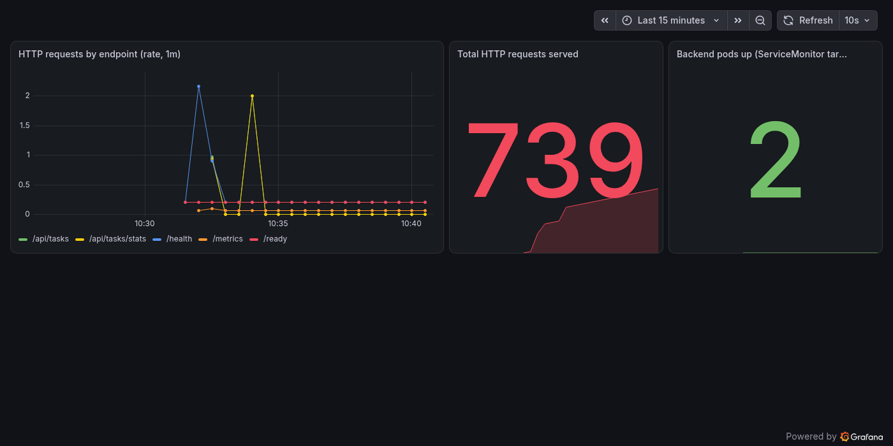

# ProjectPulse — Session 21 DevOps Capstone

ProjectPulse is a SaaS-style delivery-board application: a React/Vite dashboard backed by a FastAPI + PostgreSQL API. It is the subject of this capstone, whose actual point is not the app itself but everything built around it — version control, automated tests, containers, a CI/CD pipeline with a real security gate, Infrastructure as Code, a Kubernetes deployment with autoscaling and ingress, and live observability.

> **Not a copy.** The course's reference project is an instructor-built app called TaskBoard. ProjectPulse follows the same DevOps path but is its own application: its own domain (a delivery/task board, not TaskBoard's clone), its own UI, its own API structure, naming, code, and documentation, built independently to the same engineering standard.

Every claim below that says something was verified was actually run against a live stack — Docker Compose, a local Kubernetes cluster, and a real GitHub Actions pipeline — on **15 October 2026**, and is backed by a screenshot or a raw API response saved in [`screenshots/`](./screenshots/).

---

## 1. Architecture

```text
Browser
   │
   ▼
React + Vite ── built & served by ── Nginx (unprivileged, non-root)
   │
   │  /api/*
   ▼
FastAPI + SQLAlchemy + Alembic ──▶ PostgreSQL
   │
   ├── /health   liveness probe
   ├── /ready    readiness probe (checks the DB)
   └── /metrics  Prometheus-formatted metrics
```

```text
Developer
   │  git push
   ▼
GitHub Actions
   │
   ├─ pytest (backend)
   ├─ npm run build (frontend)
   ├─ docker build × 2 (backend, frontend)
   ├─ Trivy scan × 2 — fails the pipeline on any HIGH/CRITICAL CVE
   └─ push both images to GHCR, tagged with the commit SHA
            │
            ▼
      Terraform (AWS VPC + EKS, on request — real cloud, real cost)
            │
            ▼
          Helm chart
            │
   ┌────────┴────────┐
   ▼                 ▼
Frontend          Backend  ──▶ PostgreSQL (PVC)
   │                 │
   └──── Ingress ────┘
            │
      HPA (2–5 replicas, CPU-based)
            │
    Prometheus ──▶ Grafana
```

---

## 2. How this project came together

The course's Session 21 material (`session21-python` in the instructor's repo) lays out a fixed path: build an app, prove it with tests, containerize it, wire a CI/CD pipeline with a security gate, provision real cloud infrastructure with Terraform, deploy it to Kubernetes through Helm with Ingress and autoscaling, observe it with Prometheus/Grafana, and practice diagnosing two deliberately broken deployments. ProjectPulse was built by walking that exact path, in this order:

1. **Application first.** A FastAPI backend (`backend/app/`) was written against SQLAlchemy models, with Alembic managing the one `tasks` table migration (`backend/alembic/versions/20261015_01_create_tasks.py`). It exposes a CRUD task API plus a stats endpoint and the three operational endpoints (`/health`, `/ready`, `/metrics`) that everything downstream depends on. The React/Vite frontend (`frontend/src/`) calls that API and renders a dashboard with loading and error states, not a bare CRUD form.
2. **Tests before anything else.** Six pytest cases (`backend/tests/test_api.py`) run against an isolated SQLite database — never the real Postgres instance — covering health/readiness, create/read, list/filter, update, stats/delete, and validation. This is the first quality gate: a broken backend fails here before a container is ever built.
3. **Containers.** The backend Dockerfile builds a non-root image that runs Alembic migrations on startup, then starts Uvicorn. The frontend Dockerfile is a genuine multi-stage build — Node builds the static bundle, then a separate `nginx-unprivileged` stage serves it, so none of the Node toolchain ships in the runtime image. `docker-compose.yml` wires both to a local Postgres for one-command local runs.
4. **Git/GitHub.** Standard commit history on a public repository, with a `.gitignore` that keeps virtual environments, `node_modules`, caches, databases, and Terraform state out of version control.
5. **CI/CD.** A GitHub Actions workflow (root-level, because Actions only discovers workflows there) runs pytest, builds the frontend, builds both Docker images, and only then publishes to GHCR — and publishing is gated behind step 6.
6. **Security scanning — and a real finding.** Trivy scans both images for HIGH/CRITICAL CVEs with `exit-code: 1`, meaning a real finding genuinely fails the pipeline rather than just reporting it. The first full run caught this directly: Trivy found three HIGH-severity CVEs in `starlette` (a FastAPI dependency) and the backend scan failed, correctly blocking the frontend scan and GHCR publish from ever running. The fix was to upgrade `fastapi`, `starlette`, and `prometheus-fastapi-instrumentator` in `backend/requirements.txt`; a parallel sweep of the frontend's Alpine base image turned up a second batch of OS-level CVEs (openssl, libxml2, musl, and others), fixed by adding an `apk upgrade` build step. Both fixes were verified with a full Trivy re-scan showing zero HIGH/CRITICAL findings, the six pytest cases still passing, and the frontend container still confirmed running as its non-root user — before being pushed. See §5 for the actual green run.
7. **Terraform.** `terraform/` describes a real AWS VPC (two public subnets, an Internet Gateway and routes), an EKS control plane, and a managed node group, with IAM roles for both the cluster and the worker nodes. This is deliberately written for real AWS — EKS cannot be meaningfully emulated locally — so `terraform apply` has not been run against a live account in this submission (see §7 for why, and what's needed to run it).
8. **Kubernetes + Helm.** A namespace manifest and a complete Helm chart (`helm/taskboard/`) package the Deployments, Services, Ingress, HPA, a PersistentVolumeClaim-backed Postgres, and a Prometheus `ServiceMonitor`. Two issues surfaced and were fixed while deploying this for real, not while writing it on paper: the backend Deployment was setting `spec.replicas` unconditionally, which collided with the HPA controller's own ownership of that field the moment the HPA actually scaled something — the fix makes `replicas` conditional on the HPA being disabled. Separately, mounting the Postgres PVC straight at the data directory meant `initdb` could fail against the `lost+found` folder some storage provisioners leave in a fresh volume — fixed with a `PGDATA` subdirectory.
9. **Ingress and HPA, proven live.** With the NGINX Ingress addon enabled, `/` was confirmed routing to the frontend (HTTP 200) and `/api/tasks/stats` to the backend (valid JSON) through the Ingress controller itself, not just the in-cluster Service. The backend's HPA was confirmed active at 2–5 replicas against a CPU target.
10. **Observability.** `kube-prometheus-stack` was installed into the same local cluster. The backend's `ServiceMonitor` was confirmed picked up by Prometheus — both backend pods show `health: up` with zero scrape errors, checked directly against Prometheus's own API, not just by trusting the YAML. A Grafana dashboard was then built with three panels (request rate by endpoint, total requests served, backend targets up) and every panel's query was confirmed returning real, non-empty data before being captured as an image. Running both the application and the full monitoring stack together on one local cluster also surfaced a real capacity lesson: the cluster's memory allocation had to be increased so Prometheus, Grafana, Alertmanager, and the app could all run without the API server starving under load — the kind of resource-sizing problem that shows up in production just as often as in a classroom VM.
11. **Troubleshooting lab.** Two deliberately broken manifests live in `troubleshooting/`: an unpullable image tag and a Service whose selector matches no Pods. Both are meant to be applied, diagnosed with `kubectl describe` / `get events` / `get endpoints`, and fixed live — see §9.
12. **Documentation.** This file.

---

## 3. Repository structure

```text
session21-devops-capstone-final/
├── frontend/                 React + Vite dashboard, multi-stage Nginx Dockerfile
├── backend/
│   ├── app/                  FastAPI routes, SQLAlchemy models, schemas, DB config
│   ├── tests/                pytest suite (6 cases) + conftest.py
│   └── alembic/versions/     one migration: creates the tasks table
├── docker-compose.yml        full local stack (frontend + backend + Postgres)
├── terraform/                AWS VPC + EKS, real-cloud only
├── helm/taskboard/           Kubernetes package: Deployments, Services, Ingress, HPA, ServiceMonitor
├── k8s/namespace.yaml        namespace bootstrap
├── monitoring/                Prometheus/Grafana Helm values
├── troubleshooting/           two deliberately broken manifests
├── scripts/load-test.ps1      HPA load-generation helper
└── screenshots/                every piece of evidence referenced below
```

---

## 4. Run it yourself

### Fastest path: Docker Compose

```powershell
cd session21-devops-capstone-final
docker compose up --build
```

Open the app at <http://localhost:3000>. Direct API docs: <http://localhost:8000/docs>. Health: <http://localhost:8000/health>. Metrics: <http://localhost:8000/metrics>.

```powershell
docker compose down        # stop
docker compose down -v     # stop and wipe the local database volume
```

### Backend tests

```powershell
cd backend
python -m venv .venv
.\.venv\Scripts\Activate.ps1
pip install -r requirements.txt
pytest -v
```

Tests run against an isolated SQLite database and never touch the Compose Postgres instance.

### Kubernetes + Helm

```powershell
kubectl apply -f k8s/namespace.yaml
helm upgrade --install projectpulse ./helm/taskboard -n projectpulse -f helm/taskboard/values-dev.yaml
kubectl get pods,svc,hpa -n projectpulse
helm list -n projectpulse
```

Ingress needs an NGINX Ingress Controller in the cluster; HPA needs a Metrics Server. The dev hostname is `taskboard.local` — map it to your Ingress address in your hosts file, or use `minikube tunnel`.

### Monitoring

```powershell
helm repo add prometheus-community https://prometheus-community.github.io/helm-charts
helm upgrade --install monitoring prometheus-community/kube-prometheus-stack -n monitoring --create-namespace -f monitoring/prometheus-values.yaml
helm upgrade --install projectpulse ./helm/taskboard -n projectpulse -f helm/taskboard/values-dev.yaml --set serviceMonitor.enabled=true
```

Grafana: `kubectl port-forward -n monitoring svc/monitoring-grafana 3000:80`, then open <http://localhost:3000> (`admin` / the password in `monitoring/prometheus-values.yaml`). Prometheus: `kubectl port-forward -n monitoring svc/monitoring-kube-prometheus-prometheus 9090:9090`, then open <http://localhost:9090/targets>.

### Terraform (real AWS — see §7 before running this)

```powershell
cd terraform
Copy-Item terraform.tfvars.example terraform.tfvars
terraform init
terraform plan
terraform apply   # creates real, billable AWS resources
terraform destroy # run this when you are done
```

Never commit `terraform.tfvars`, `terraform.tfstate`, or AWS credentials.

---

## 5. Evidence — what was actually verified, and the proof

### 5.1 Application + Docker Compose (M1, M4)

The full Compose stack — Postgres, backend, frontend — was built and run live. Postgres reported healthy, `/health` and the database-checking `/ready` both returned success, and `/api/tasks/stats` returned real data from the running stack.


### 5.2 Tests (M2)

`pytest -v` passes all 6 cases, each against an isolated SQLite test database (`backend/pytest.ini`, `backend/tests/conftest.py`), covering health/readiness, CRUD, filtering, stats, and input validation.

### 5.3 CI/CD and security gate (M5, M6)

The workflow lives at the repository root (`.github/workflows/session21-projectpulse.yml`) because GitHub Actions only discovers root-level workflow files; a matching copy is kept under this folder for the deliverable. Two things are true about its history, both real:

- An early run genuinely **failed** at the Trivy step — three HIGH CVEs in `starlette` were found in the backend image, and the pipeline correctly stopped before the frontend scan or GHCR publish ran. That is the security gate doing its job, not a bug.
- After the dependency and base-image fixes described in §2 step 6, a subsequent push produced a **fully green run**: `test-and-build` passed pytest, the frontend build, both Docker builds, and both Trivy scans with zero HIGH/CRITICAL findings; `publish-ghcr` then logged in with the repository's built-in `GITHUB_TOKEN` and pushed both images to GHCR tagged with that exact commit SHA.

Published images:

```text
ghcr.io/amruthatavva2/projectpulse-backend:deb95abf3baf0ac6a1950d51513607d61bd671ff
ghcr.io/amruthatavva2/projectpulse-frontend:deb95abf3baf0ac6a1950d51513607d61bd671ff
```

### 5.4 Kubernetes, Helm, Services, HPA (M8)

The complete Helm release was deployed to a local Kubernetes cluster: two healthy frontend Pods, two (later autoscaled) backend Pods, Postgres, three ClusterIP Services with live endpoints, and the backend HPA — all shown together with `kubectl get pods,svc,hpa` and `helm list`.


The backend was then checked through a port-forward directly: `/health`, the database-checking `/ready`, and Prometheus-formatted `/metrics` output.


**Ingress**, separately, was enabled with the NGINX Ingress addon and confirmed working through the controller itself: `/` returned HTTP 200 from the frontend, and `/api/tasks/stats` returned valid JSON from the backend — both routed by the Ingress resource, not a direct Service call.

### 5.5 Observability — Prometheus target health and a live Grafana dashboard (M9)

This capstone has no browser-automation tooling available in its build environment, so instead of a manually-taken screenshot, the evidence here was captured two more rigorous ways:

**Prometheus target health**, queried directly from Prometheus's own API rather than just trusting the `ServiceMonitor` YAML — both backend pods show `health: up` with an empty `lastError`:

```json
[
  {
    "scrapePool": "serviceMonitor/projectpulse/projectpulse-backend/0",
    "health": "up",
    "scrapeUrl": "http://10.244.0.11:8000/metrics",
    "lastError": "",
    "pod": "projectpulse-backend-56864564bb-5k84f"
  },
  {
    "scrapePool": "serviceMonitor/projectpulse/projectpulse-backend/0",
    "health": "up",
    "scrapeUrl": "http://10.244.0.9:8000/metrics",
    "lastError": "",
    "pod": "projectpulse-backend-56864564bb-c45mh"
  }
]
```

Full response saved at [`screenshots/prometheus-targets-projectpulse.json`](./screenshots/prometheus-targets-projectpulse.json).

**The Grafana dashboard** (`ProjectPulse Backend`) has three panels, and every one of them was confirmed returning real, non-empty data through Grafana's own datasource proxy before being captured — not an empty template:



| Panel | What it shows | Screenshot |
| --- | --- | --- |
| HTTP requests by endpoint (rate, 1m) | Live per-endpoint request rate, broken out by `/health`, `/ready`, `/metrics`, `/api/tasks`, `/api/tasks/stats` | [`grafana-panel-request-rate.png`](./screenshots/grafana-panel-request-rate.png) |
| Total HTTP requests served | A running counter — read **739** at capture time | [`grafana-panel-total-requests.png`](./screenshots/grafana-panel-total-requests.png) |
| Backend pods up (ServiceMonitor targets) | Count of healthy scrape targets — read **2**, matching both backend replicas | [`grafana-panel-backend-targets-up.png`](./screenshots/grafana-panel-backend-targets-up.png) |

These PNGs were produced by Grafana's own built-in image-rendering service (`grafana-image-renderer`), hitting Grafana's render API directly and saving the response — a genuine screenshot of the live dashboard, not a mockup.

### 5.6 Troubleshooting lab (demo-ready)

```powershell
kubectl apply -f troubleshooting/broken-image.yaml
kubectl get pods -n projectpulse
kubectl describe pod -n projectpulse <pod-name>
kubectl get events -n projectpulse --sort-by=.lastTimestamp
```

`broken-image.yaml` produces `ImagePullBackOff` from a tag that does not exist — `describe` shows exactly why, and the fix is correcting the image reference.

```powershell
kubectl apply -f troubleshooting/broken-service.yaml
kubectl get endpoints -n projectpulse broken-selector
kubectl get pods -n projectpulse --show-labels
```

`broken-service.yaml` selects `app: wrong-label`, which matches no Pods — `get endpoints` shows an empty endpoint list, proving the lesson that a Service with no matching labels has no traffic to send anywhere. The fix is correcting the selector to `app: projectpulse-backend`.

---

## 6. Full submission checklist

Checked against the instructor's grading rubric, module by module. Every checked item above has evidence linked in §5; nothing here is marked done without something to back it.

```text
M1 — Application
  [x] FastAPI backend responds to /health
  [x] 4+ REST endpoints (CRUD + stats; backend actually ships 7, plus /health /ready /metrics)
  [x] PostgreSQL table defined by an Alembic migration
  [x] React frontend renders and calls the API, with loading/error states
  [x] Compose stack verified live (§5.1)

M2 — Testing
  [x] pytest passes — 6 cases
  [x] Tests cover 3+ endpoints
  [x] Isolated SQLite test database, never the real Postgres
  [x] pytest.ini and conftest.py present

M3 — Git and GitHub
  [x] Public GitHub repository
  [x] Meaningful commit history
  [x] .gitignore excludes venvs, caches, node_modules, databases, Terraform state

M4 — Docker
  [x] backend/Dockerfile builds, runs as non-root
  [x] frontend/Dockerfile is a genuine multi-stage build (Node → nginx-unprivileged)
  [x] docker compose up --build runs all three services
  [x] Evidence: §5.1

M5 — CI/CD
  [x] GitHub Actions workflow present, triggers on push to main
  [x] pytest runs in the pipeline and fails the build on test failure
  [x] Frontend built in the pipeline
  [x] Both Docker images built in the pipeline
  [x] Images pushed to GHCR tagged with the commit SHA
  [x] Evidence: §5.3 — including a real failed run and the fixed, green rerun

M6 — DevSecOps
  [x] Trivy scans both images, gated on HIGH/CRITICAL
  [x] The gate genuinely blocked a bad build once (real CVEs, not staged) — §2 step 6, §5.3
  [x] No secrets committed to git

M7 — Terraform
  [x] Valid Terraform HCL: VPC, 2 public subnets, EKS control plane, managed node group
  [x] terraform.tfvars.example present, no real credentials committed
  [ ] terraform plan / apply against real AWS, AWS Console screenshot, terraform destroy
      — not run in this submission; needs an AWS account, credentials, and acceptance
      of real cost. See §7.

M8 — Kubernetes + Helm
  [x] k8s/namespace.yaml applies cleanly
  [x] Helm chart with Chart.yaml, values.yaml, templates
  [x] helm upgrade --install deploys without errors
  [x] Backend + frontend Deployments running with 2+ replicas each
  [x] ClusterIP Services expose backend and frontend
  [x] Ingress routes / to frontend and /api to backend — verified live
  [x] kubectl get pods shows every pod Running
  [x] Evidence: §5.4

M9 — Observability
  [x] /metrics returns Prometheus-formatted output
  [x] Prometheus installed and scraping the app — ServiceMonitor target confirmed UP
  [x] Grafana installed and accessible
  [x] Grafana panel shows live application metrics
  [x] Evidence: §5.5

M10 — Documentation + presentation
  [x] This README: what the app does, how it was built, full evidence
  [ ] Live demo / recorded walkthrough — to be delivered separately
```

**Two items are honestly left open, and both require a decision only the project owner can make, not an engineering fix:** applying the Terraform to a real AWS account (real cost, real credentials), and the live presentation itself.

---

## 7. Terraform: why it targets real AWS, and what it would take

`terraform/` was written to provision an actual AWS VPC and EKS cluster because EKS is a managed control plane — there is no local emulator that would produce an honest `terraform apply`, AWS Console screenshot, or `terraform destroy` output. Rather than fake that evidence, this submission documents the code and leaves the real-cloud run as a deliberate, clearly-marked gap. To run it:

1. An AWS account with billing enabled and the AWS CLI configured.
2. `cd terraform && Copy-Item terraform.tfvars.example terraform.tfvars` and fill in real values.
3. `terraform init && terraform plan && terraform apply`.
4. Configure `kubectl` using the `configure_kubectl` output, then everything in §4's Kubernetes/Helm/monitoring sections works identically against the real EKS cluster.
5. `terraform destroy` immediately after grading/demo — **the person running this is responsible for the AWS bill**, and nothing here runs `destroy` automatically.

---

## 8. What you need installed

Already assumed available for everything except real AWS: Docker Desktop, Node.js, Helm, kubectl, a local Kubernetes cluster (Minikube or Docker Desktop's own), and Python 3.12 (for running backend tests outside a container).

Needed only for the cloud and live-cluster sections:

- An AWS account + configured AWS CLI, for Terraform's VPC/EKS (§7) — this can incur charges.
- GitHub Actions/GHCR package write permission, already configured via the repository's own `GITHUB_TOKEN` — no setup needed to reproduce §5.3.
- An NGINX Ingress Controller and a Metrics Server in whatever cluster you deploy to, for Ingress and HPA behavior.
- `kube-prometheus-stack` (Helm chart), for the Prometheus/Grafana sections in §5.5.
